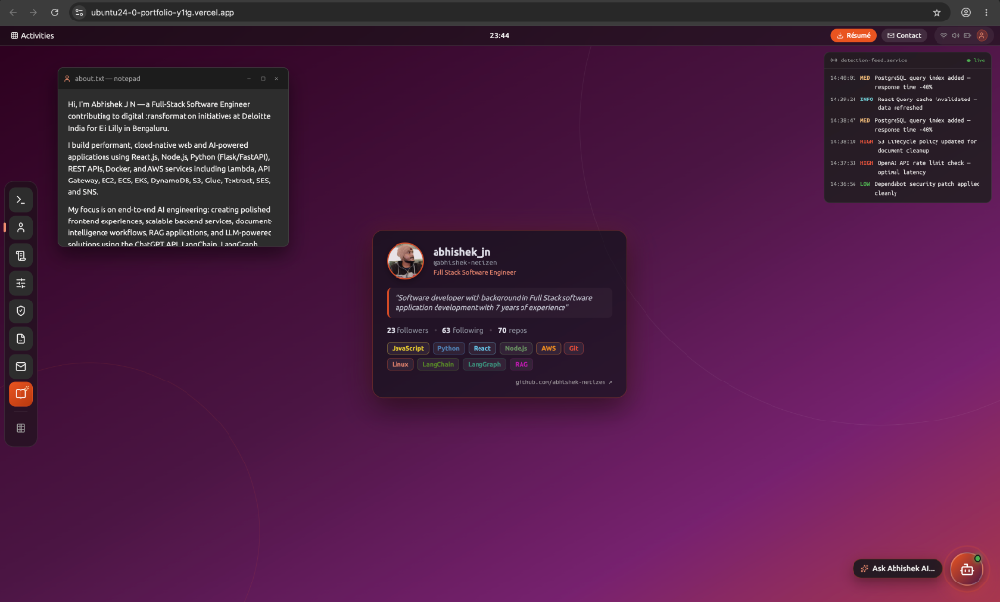

# ABHISHEK-OS — Ubuntu Portfolio & AI Digital Twin

> 🖥️ **Live Demo**: [ubuntu24-0-portfolio-y1tg.vercel.app](https://ubuntu24-0-portfolio-y1tg.vercel.app/)



An interactive **Ubuntu 24.04 LTS desktop** portfolio for **Abhishek J N** — Full Stack Software Engineer at Deloitte India. Features a fully functional GNOME desktop environment with an AI-powered Digital Twin chatbot trained on my resume.

---

## Features

- 🖥️ Ubuntu GNOME Desktop (top bar, dock, draggable windows, boot sequence)
- 🤖 AI Digital Twin — answers recruiter questions via OpenAI / OpenRouter
- 💻 Interactive Terminal — `neofetch`, `ls`, `cat`, `open <app>`, and more
- 🐙 GitHub profile card on the desktop wallpaper
- 🏆 Stack Overflow stats in the system tray
- 📄 Résumé, About, Skills, Projects, Contact windows

---

## Customize for Yourself

1. Edit **`profile.json`** — update your name, role, links, bio, and skills.
2. Replace **`backend/twin/resume.pdf`** with your own resume.

Done. Both the desktop UI and AI assistant update automatically.

---

## Local Development

```bash
npm install

python3 -m venv backend/venv
backend/venv/bin/pip install -r backend/requirements.txt

echo "OPENAI_API_KEY=sk-or-v1-..." > backend/.env

npm run dev:react
```

Open `http://localhost:5173`

---

## Deploy to Vercel (Free)

1. Push your repo to **GitHub**.
2. Go to **[vercel.com/new](https://vercel.com/new)** → Import your repository.
   - Root Directory: **repository root** (not `backend/`)
   - Framework: auto-detected as **Vite**
3. Add Environment Variable:

   | Key | Value |
   |---|---|
   | `OPENAI_API_KEY` | OpenAI (`sk-proj-...`) or OpenRouter (`sk-or-v1-...`) key |

4. Click **Deploy**. Any `git push` to `main` auto-redeploys. 🎉

---

## Tech Stack

| Layer | Tech |
|---|---|
| Frontend | React 18, Vite, Vanilla CSS |
| AI Backend | Python, OpenAI SDK, Vercel Serverless |
| Deployment | Vercel (free tier) |

---

MIT License © Abhishek J N
